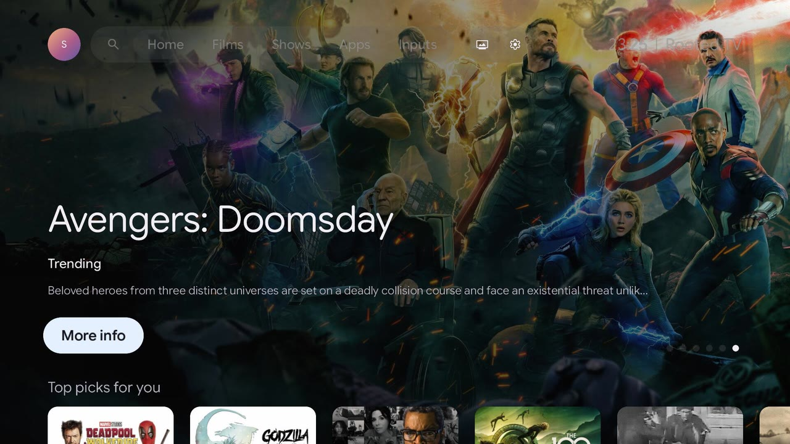
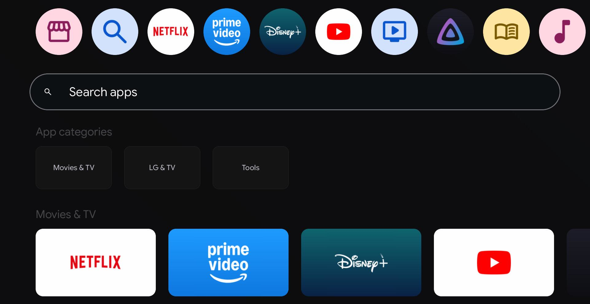
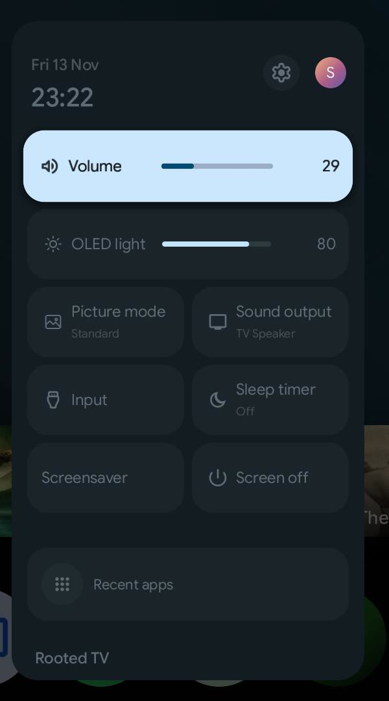

<h1 align="center">Rooted TV</h1>

<p align="center"><b>Google TV's home on LG webOS TVs.</b><br>A native launcher for rooted LG TVs, built for webOS 3.4.</p>

<p align="center">
  
</p>

**Rooted TV**, inspired by [Native Tv](https://github.com/ihtisham1211/native-tv), replaces an LG webOS TV's home screen with a copy of Google TV's: the same Home with its banner and rows of titles, the Films, Shows, Apps and Inputs tabs, a page for each title, Search, Quick settings and profiles. It is a C++ and OpenGL ES app that runs on the TV itself, with no browser behind it, at the display's 60 frames a second, and it speaks the TV's menu language.

Beside the app, a server on the TV gives phones and computers a dashboard, privacy tools and a Home Assistant bridge.

<p align="center">
  
  
</p>
<p align="center"><sub>Captured on an LG OLED55C6V.</sub></p>

## Features

* **Google TV's Home.** A banner of trending titles with their logos and HD trailers; rows of Top picks for you (chosen by Gemini when a Gemini key is set), Continue watching, what is popular on Netflix, Prime Video and Disney+ in the TV's country, and YouTube's trending videos and each profile's subscriptions.
* **Films, Shows, Apps and Inputs tabs.** Rows by genre with a caption for the focused row, the installed apps laid out as Google TV's Apps tab, and the HDMI inputs named after the device on each.
* **A title's page.** Overview, rating, cast and crew, similar titles and rows of its genres, with Watch on Prime Video or Disney+, which opens the title itself, Trailer, Watchlist, Watched it? and Like or Not for me.
* **Search.** By title or genre, and in LG Content Store, whose apps install from the results.
* **Quick settings.** Google TV's panel: volume, OLED light, picture mode, sound output, input, sleep timer, screensaver, screen off and recent apps.
* **Profiles and assistant.** Google TV's account chooser, with YouTube signed in for each profile, and a Gemini assistant.
* **Sounds and screen savers.** Google TV's system sound on each key press; Google TV's screen saver, an ambient mode with the owner's photos, a clock and other savers in place of LG's.
* **The TV's language.** The app follows the TV's menu language where it has a translation, in Google TV's own words where it has the same string, with titles, overviews and genres from TMDB in that language. The app's settings, setup and tools stay in English.
* **Switching on.** The TV opens Home when it comes on and on the Home key. If the device on the input, such as a Chromecast woken with the TV over HDMI-CEC, takes the screen back within 10 seconds, Home comes back over it; if that device switched the TV on, the device stays in front.
* **Built for webOS 3.4.** The server starts from the app's tile, since the firmware runs nothing as root at boot; still logos dim on OLED panels that have no logo dimming of their own; memory is freed for the streaming apps.
* **A dashboard in the browser.** For a phone or computer, in Google TV's look: remote control, apps, privacy (LG's ACR and ad tracking, a blocker for LG's ad and telemetry servers), OLED care, hardware readings, backup and logs. The TV appears in [Home Assistant](docs/integrations/home-assistant.md) over MQTT.

## Compatibility

| | |
| :-- | :-- |
| **Tested on** | LG OLED55C6V (2016), webOS 3.4.3, firmware 05.70.45 |
| **Other models** | Untried with Rooted TV. The server and the app are written for webOS 3.4 and later |
| **Requirements** | A rooted TV with the [Homebrew Channel](https://github.com/webosbrew/webos-homebrew-channel) and root SSH access |

## Install

Rooted TV is built on a computer on the TV's network and installed over SSH. The TV needs no internet access to install it.

1. Root the TV and install the [Homebrew Channel](https://github.com/webosbrew/webos-homebrew-channel). Rooted TV does not root the TV.
2. Clone the repository:

   ```bash
   git clone git@github.com:Markk2317/-.git rooted-tv && cd rooted-tv
   ```

3. Get the webOS SDK. On Linux x86_64:

   ```bash
   mkdir -p ~/webos-sdk
   curl -fsSL https://github.com/openlgtv/buildroot-nc4/releases/download/webos-d7ed7ee/arm-webos-linux-gnueabi_sdk-buildroot.tar.gz | tar -xz -C ~/webos-sdk
   ~/webos-sdk/arm-webos-linux-gnueabi_sdk-buildroot/relocate-sdk.sh
   ```

   macOS and Linux arm64 use the [webOSbrew native SDK](docs/getting-started/install.md#get-the-sdk).

4. Build the server and the app:

   ```bash
   SDK=~/webos-sdk/arm-webos-linux-gnueabi_sdk-buildroot
   PATH=$SDK/bin:$PATH python3 native-tv/build.py --sdk $SDK
   ```

5. Install them on the TV with its root SSH key:

   ```bash
   NATIVETV_SSH_KEY=~/.ssh/lgtv_root bash native-tv/lifecycle/deploy.sh <tv-ip>
   ```

6. Open the app from its tile on the TV: it starts the server and runs the first-run setup. The dashboard is at `http://<tv-ip>:8080/`.

The [installation guide](docs/getting-started/install.md) and [what it changes on the TV](docs/administration/tv-changes.md) have the details.

## Optional keys

The app, the dashboard and the tools need no account or key. Keys add Home's rows of titles, and go in the dashboard's Home tab (`http://<tv-ip>:8080/?tab=home`):

| Key | What it adds |
| :-- | :-- |
| TMDB (free, [themoviedb.org](https://www.themoviedb.org/settings/api)) | The film and series rows, the Films and Shows tabs, what is popular on Netflix, Prime Video and Disney+, title pages and trailers. Without it Home shows only what is on the TV |
| YouTube Data API (free, [Google Cloud](https://console.cloud.google.com/)) | The Trending on YouTube row |
| Gemini | Top picks chosen by Gemini, and the assistant |
| Google OAuth client (TVs and Limited Input devices) | The YouTube subscriptions of each profile signed in with Google |

The keys stay on the TV, in `/var/lib/tvweb/config.json`. This product uses the TMDB API but is not endorsed or certified by TMDB.

## Security

The dashboard has **no login by default**, so any phone on the home network can use it. **Never expose port 8080 to the internet.** [Security](docs/administration/security.md) covers the access token and closing the port to the network.

## Disclaimer

Rooted TV runs as `root` on the TV and is used at the owner's own risk: no responsibility is accepted for damage, bricked TVs, voided warranties or panel issues.

An independent, unofficial project, not affiliated with or endorsed by LG Electronics or Google. webOS is a trademark of LG Electronics; Google TV and Chromecast are trademarks of Google LLC.

## License

MIT, see [LICENSE](LICENSE). Bundled fonts, icons, sounds and libraries keep their own licences, listed in [THIRD-PARTY-NOTICES.md](THIRD-PARTY-NOTICES.md).
