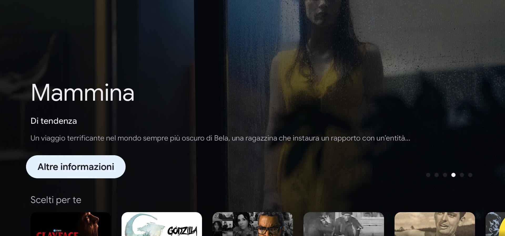
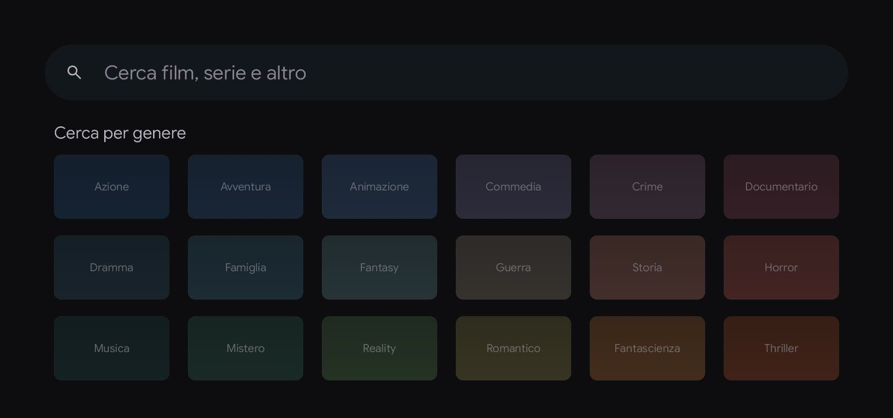

<h1 align="center">Salotto</h1>

<p align="center"><b>La home di Google TV sui televisori LG webOS.</b><br>Un launcher nativo per i televisori LG rootati, costruito per i modelli con webOS 3.4.</p>

<p align="center">
  
</p>

**Salotto** sostituisce la home di un televisore LG webOS con una copia di quella di Google TV: la stessa Home con il banner e le righe di titoli, le schede Film, Programmi, App e Ingressi, la pagina di ogni titolo, la ricerca, le impostazioni rapide e i profili. È un'app C++ e OpenGL ES che gira sul televisore stesso, senza browser, a 60 fotogrammi al secondo, e parla la lingua dei menu del televisore.

Accanto all'app, un server sul televisore offre una dashboard per telefono e computer, gli strumenti per la privacy e il collegamento a Home Assistant.

<p align="center">
  
  
</p>
<p align="center"><sub>Schermate catturate su un LG OLED55C6V con i menu in italiano.</sub></p>

## Cosa fa

* **Home come Google TV.** Il banner con i titoli di tendenza, i loro loghi e i trailer in HD; le righe Scelti per te (scelti da Gemini, con una chiave Gemini), Continua a guardare, i titoli popolari su Netflix, Prime Video e Disney+ nel paese del televisore, YouTube di tendenza e dalle iscrizioni di ogni profilo.
* **Schede Film, Programmi, App e Ingressi.** Le righe per genere con la didascalia della riga selezionata, le app installate disposte come su Google TV, gli ingressi HDMI con il nome del dispositivo collegato.
* **La pagina di un titolo.** Trama, voto, cast e troupe, titoli simili e righe per genere; i pulsanti Guarda su Prime Video o Disney+, che aprono il titolo direttamente, Trailer, Lista di titoli, Già guardato e pollice su o giù.
* **Ricerca.** Per titolo o per genere, e tra le app del LG Content Store, da installare dai risultati.
* **Impostazioni rapide.** Il pannello di Google TV: volume, luce OLED, modalità immagine, uscita audio, ingresso, timer di sospensione, salvaschermo, schermo spento e app recenti.
* **Profili e assistente.** La scelta dell'account di Google TV, con YouTube collegato per profilo, e un assistente Gemini.
* **Suoni e salvaschermi.** Il suono di sistema di Google TV a ogni tasto; il salvaschermo di Google TV, la modalità ambiente con le proprie foto, l'orologio e gli altri salvaschermi al posto di quello di LG.
* **In italiano.** L'app segue la lingua dei menu del televisore, con le parole di Google TV dove ha la stessa frase, e titoli, trame e generi da TMDB in italiano. Le impostazioni dell'app, la configurazione iniziale e gli strumenti restano in inglese.
* **All'accensione.** Il televisore apre la Home all'accensione e con il tasto Home. Se il dispositivo sull'ingresso, come un Chromecast acceso insieme al televisore via HDMI-CEC, si riprende lo schermo nei primi 10 secondi, la Home torna davanti; se è stato quel dispositivo ad accendere il televisore, resta il dispositivo.
* **Pensato per webOS 3.4.** Il server parte dalla tile dell'app, dato che il firmware non avvia nulla come root all'accensione; i loghi fissi si attenuano sui pannelli OLED che non lo fanno da soli; la memoria si libera per le app di streaming.
* **Dashboard dal browser.** Da telefono o computer, con l'aspetto di Google TV: telecomando, app, privacy (ACR e tracciamento di LG, blocco dei server di pubblicità e telemetria), cura del pannello OLED, letture dell'hardware, backup e log. Il televisore appare in [Home Assistant](docs/integrations/home-assistant.md) tramite MQTT.

## Compatibilità

| | |
| :-- | :-- |
| **Provato su** | LG OLED55C6V (2016), webOS 3.4.3, firmware 05.70.45 |
| **Altri modelli** | Non provati con Salotto. Il server e l'app sono scritti per webOS 3.4 e successivi |
| **Requisiti** | Televisore rootato con l'[Homebrew Channel](https://github.com/webosbrew/webos-homebrew-channel) e accesso SSH come root |

## Installazione

Si installa da un computer sulla stessa rete del televisore, che compila l'app e la copia via SSH. Il televisore non ha bisogno di internet per l'installazione.

1. Fare il root del televisore e installare l'[Homebrew Channel](https://github.com/webosbrew/webos-homebrew-channel). Salotto non fa il root del televisore.
2. Scaricare il codice:

   ```bash
   git clone git@github.com:Markk2317/-.git salotto && cd salotto
   ```

3. Scaricare l'SDK per webOS. Su Linux x86_64:

   ```bash
   mkdir -p ~/webos-sdk
   curl -fsSL https://github.com/openlgtv/buildroot-nc4/releases/download/webos-d7ed7ee/arm-webos-linux-gnueabi_sdk-buildroot.tar.gz | tar -xz -C ~/webos-sdk
   ~/webos-sdk/arm-webos-linux-gnueabi_sdk-buildroot/relocate-sdk.sh
   ```

   Su macOS e Linux arm64 c'è la build del [webOSbrew native SDK](docs/getting-started/install.md#get-the-sdk).

4. Compilare il server e l'app:

   ```bash
   SDK=~/webos-sdk/arm-webos-linux-gnueabi_sdk-buildroot
   PATH=$SDK/bin:$PATH python3 native-tv/build.py --sdk $SDK
   ```

5. Installarli sul televisore, con la chiave SSH di root del televisore:

   ```bash
   NATIVETV_SSH_KEY=~/.ssh/lgtv_root bash native-tv/lifecycle/deploy.sh <ip-del-televisore>
   ```

6. Aprire l'app dalla sua tile sul televisore: avvia il server e mostra la configurazione iniziale. La dashboard è su `http://<ip-del-televisore>:8080/`.

La [guida all'installazione](docs/getting-started/install.md) e [cosa cambia sul televisore](docs/administration/tv-changes.md) hanno i dettagli, in inglese.

## Chiavi facoltative

L'app, la dashboard e gli strumenti funzionano senza account né chiavi. Le chiavi aggiungono le righe di titoli della Home, e si inseriscono nella scheda della Home della dashboard (`http://<ip-del-televisore>:8080/?tab=home`):

| Chiave | Cosa aggiunge |
| :-- | :-- |
| TMDB (gratuita, [themoviedb.org](https://www.themoviedb.org/settings/api)) | Le righe di film e serie, le schede Film e Programmi, i titoli popolari su Netflix, Prime Video e Disney+, le pagine dei titoli e i trailer. Senza, la Home mostra solo ciò che è sul televisore |
| YouTube Data API (gratuita, [Google Cloud](https://console.cloud.google.com/)) | La riga YouTube di tendenza |
| Gemini | Scelti per te scelti da Gemini e l'assistente |
| Client OAuth di Google (TV e dispositivi con input limitato) | Le iscrizioni YouTube di ogni profilo collegato a Google |

Le chiavi restano sul televisore, in `/var/lib/tvweb/config.json`. Questo prodotto usa l'API di TMDB ma non è approvato né certificato da TMDB.

## Sicurezza

La dashboard **non ha login** di default, per essere usata da qualsiasi telefono sulla rete di casa. **La porta 8080 non va mai aperta su internet.** [Security](docs/administration/security.md) spiega il token di accesso e come chiudere la porta alla rete.

## Avvertenze

Il software gira come `root` sul televisore. Si usa a proprio rischio: nessuna responsabilità per danni, televisori bloccati, garanzie perse o problemi al pannello.

Salotto è un progetto indipendente e non ufficiale, non affiliato né approvato da LG Electronics o da Google. webOS è un marchio di LG Electronics; Google TV e Chromecast sono marchi di Google LLC.

## Licenza

MIT, vedi [LICENSE](LICENSE). Caratteri, icone, suoni e librerie incluse hanno le loro licenze, in [THIRD-PARTY-NOTICES.md](THIRD-PARTY-NOTICES.md).

Salotto è ispirato a [Native Tv](https://github.com/ihtisham1211/native-tv).
