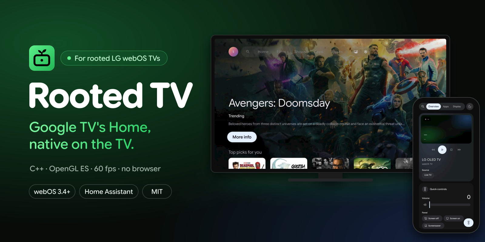
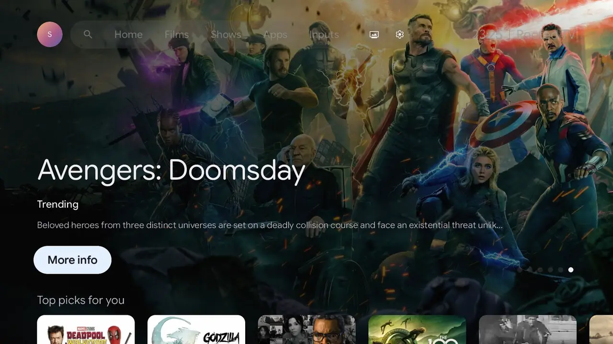
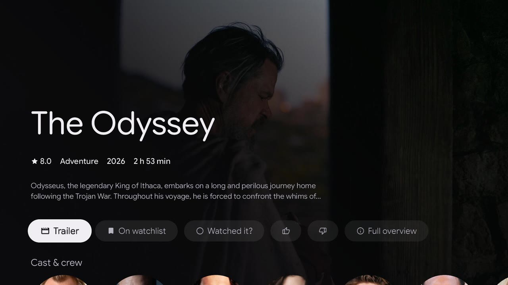
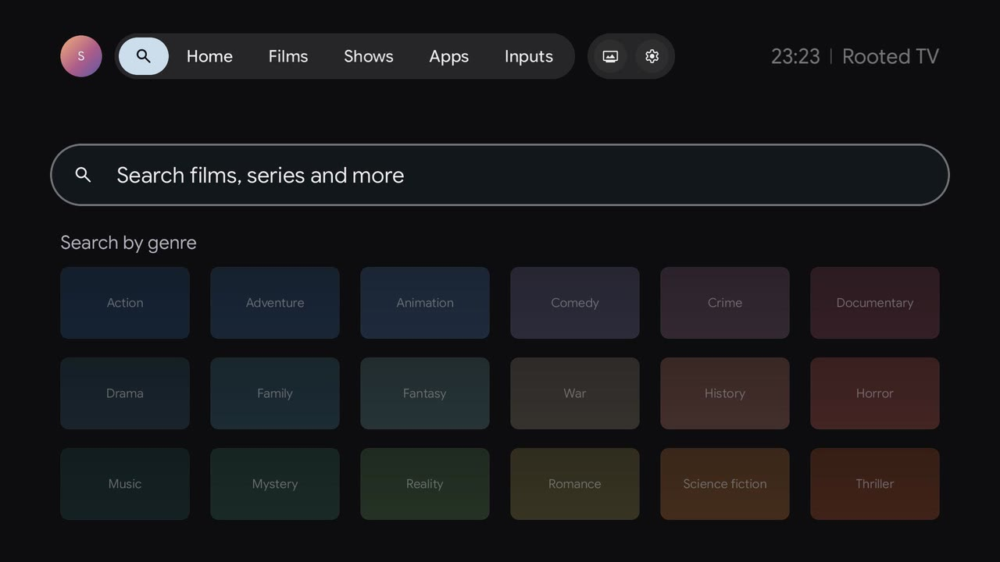
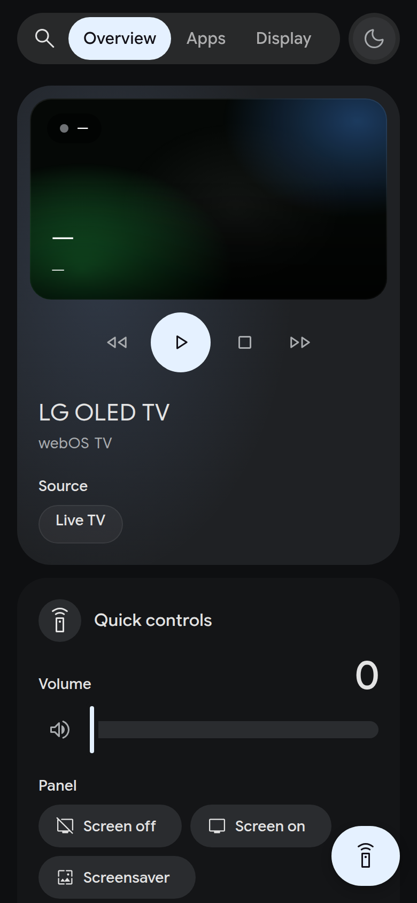
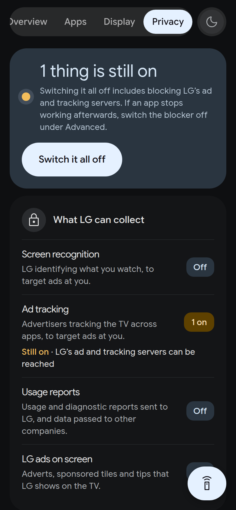
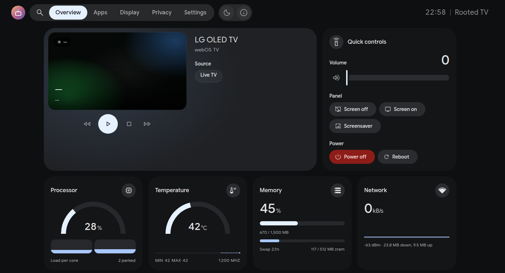
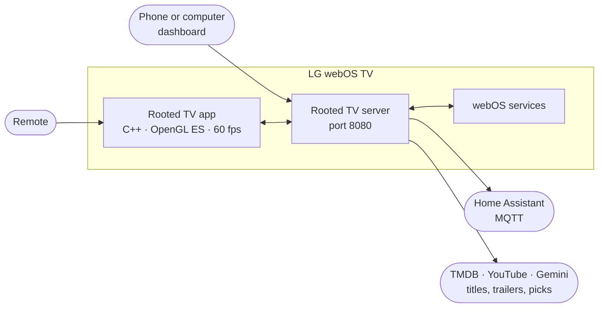

<p align="center">
  
</p>

<p align="center">
  <a href="https://github.com/Markk2317/Rooted-TV/releases"></a>
  
  
  <a href="docs/integrations/home-assistant.md"></a>
  <a href="LICENSE"></a>
</p>

<h3 align="center">Google TV's Home, running natively on rooted LG webOS TVs.</h3>

<p align="center">
  <a href="#-install"><b>Install</b></a> &nbsp;·&nbsp;
  <a href="#-screens"><b>Screens</b></a> &nbsp;·&nbsp;
  <a href="#-features"><b>Features</b></a> &nbsp;·&nbsp;
  <a href="#-faq"><b>FAQ</b></a> &nbsp;·&nbsp;
  <a href="docs/index.md"><b>Docs</b></a> &nbsp;·&nbsp;
  <a href="https://github.com/Markk2317/Rooted-TV/releases"><b>Releases</b></a>
</p>

---

**Rooted TV**, inspired by [Native Tv](https://github.com/ihtisham1211/native-tv), replaces an LG webOS TV's home screen with a copy of Google TV's: the same Home with its banner and rows of titles, the Films, Shows, Apps and Inputs tabs, a page for each title, Search, Quick settings and profiles. It is a C++ and OpenGL ES app that runs on the TV itself, with no browser behind it, at the display's 60 frames a second, and it speaks the TV's menu language.

Beside the app, a server on the TV gives phones and computers a dashboard, privacy tools and a Home Assistant bridge.

<table>
  <tr>
    <td width="33%" valign="top">
      <h3>🎬 Google TV, faithfully</h3>
      Home, tabs, title pages, Search and Quick settings follow Google TV's own layout, type, motion and system sounds.
    </td>
    <td width="33%" valign="top">
      <h3>⚡ Native and smooth</h3>
      Drawn in OpenGL ES at 60 frames a second by a C++ app on the TV. No web page, no browser engine.
    </td>
    <td width="33%" valign="top">
      <h3>🌍 The TV's language</h3>
      Menus follow the TV's menu language, with titles, overviews and genres from TMDB in the same language.
    </td>
  </tr>
  <tr>
    <td width="33%" valign="top">
      <h3>📱 A phone dashboard</h3>
      Remote control, apps, OLED care, hardware readings, backup and logs, in Google TV's look.
    </td>
    <td width="33%" valign="top">
      <h3>🛡️ Privacy</h3>
      LG's content recognition and ad tracking switched off, and LG's ad and telemetry servers blocked.
    </td>
    <td width="33%" valign="top">
      <h3>🏠 Smart home</h3>
      The TV as Home Assistant entities over MQTT, and its readings as Prometheus metrics.
    </td>
  </tr>
</table>

## 📸 Screens

<p align="center">
  
</p>

<table>
  <tr>
    <td width="50%"></td>
    <td width="50%"></td>
  </tr>
  <tr>
    <td align="center"><b>Home</b><br><sub>Trending titles with their trailers, and rows picked for each profile</sub></td>
    <td align="center"><b>A title's page</b><br><sub>Trailer, watchlist and thumbs, then its cast and similar titles</sub></td>
  </tr>
  <tr>
    <td></td>
    <td></td>
  </tr>
  <tr>
    <td align="center"><b>Apps</b><br><sub>Featured apps, the installed apps and app search, as on Google TV</sub></td>
    <td align="center"><b>Search</b><br><sub>By title or genre, and in LG Content Store</sub></td>
  </tr>
  <tr>
    <td align="center"></td>
    <td align="center">
      
      
    </td>
  </tr>
  <tr>
    <td align="center"><b>Quick settings</b><br><sub>Picture, sound, input, sleep timer and recent apps from one panel</sub></td>
    <td align="center"><b>Dashboard</b><br><sub>The TV from any phone or computer on the network</sub></td>
  </tr>
</table>

<p align="center"><sub>The TV's screens are captures from an LG OLED55C6V, the tour among them; the dashboard is a phone's browser.</sub></p>

## ✨ Features

### 📺 On the TV

* 🏠 **Google TV's Home.** A banner of trending titles with their logos and HD trailers; rows of Top picks for you (chosen by Gemini when a Gemini key is set), Continue watching, what is popular on Netflix, Prime Video and Disney+ in the TV's country, and YouTube's trending videos and each profile's subscriptions.
* 🗂️ **Films, Shows, Apps and Inputs tabs.** Rows by genre with a caption for the focused row, the installed apps laid out as Google TV's Apps tab, and the HDMI inputs named after the device on each.
* 🎞️ **A title's page.** Overview, rating, cast and crew, similar titles and rows of its genres, with Watch on Prime Video or Disney+, which opens the title itself, Trailer, Watchlist, Watched it? and Like or Not for me.
* 🔍 **Search.** By title or genre, and in LG Content Store, whose apps install from the results.
* 🎛️ **Quick settings.** Google TV's panel: volume, OLED light, picture mode, sound output, input, sleep timer, screensaver, screen off and recent apps.
* 👤 **Profiles and assistant.** Google TV's account chooser, with YouTube signed in for each profile, and a Gemini assistant.
* 🔊 **Sounds and screen savers.** Google TV's system sound on each key press; Google TV's screen saver, an ambient mode with the owner's photos, a clock and [other savers](docs/dashboard/screen-savers.md) in place of LG's.
* 🌍 **The TV's language.** The app follows the TV's menu language where it has a translation, in Google TV's own words where it has the same string, with titles, overviews and genres from TMDB in that language. The app's settings, setup and tools stay in English.
* 🔌 **Switching on.** The TV opens Home when it comes on and on the Home key. If the device on the input, such as a Chromecast woken with the TV over HDMI-CEC, takes the screen back within 10 seconds, Home comes back over it; if that device switched the TV on, the device stays in front.
* ⚙️ **Built for webOS 3.4.** The server starts from the app's tile, since the firmware runs nothing as root at boot; still logos dim on OLED panels that have no logo dimming of their own; memory is freed for the streaming apps.

The [TV app's guide](docs/apps/tv-app.md) goes through every screen.

### 📱 On a phone or computer

<p align="center">
  <picture>
    <source media="(prefers-color-scheme: light)" srcset="docs/screenshots/dashboard-light.png">
    
  </picture>
</p>

* 🕹️ **Remote and controls.** A remote control, playback, picture and sound, the panel, timers and power, from any phone or computer on the network. [Control](docs/dashboard/control.md)
* 🛡️ **Privacy.** LG's content recognition (ACR), ad tracking and data agreements, and a blocker for LG's ad and telemetry servers. [Privacy](docs/dashboard/privacy.md)
* ✨ **OLED care.** Panel hours, the pixel refresher and the panel's protections, such as Screen Shift and logo dimming. [OLED care](docs/dashboard/oled-care.md)
* 📊 **Readings, backup and logs.** Processor, temperature, memory and network, a backup of the settings, and the server's log.
* 📲 **An app of its own.** The dashboard installs on a phone's home screen or a computer's app list, with the Rooted TV icon. [Install as an app](docs/dashboard/index.md#install-as-an-app)

### 🏠 Around the house

* **Home Assistant.** The TV as one device over MQTT Discovery, with its controls and readings, and the remote's coloured buttons as triggers for automations. [Setup](docs/integrations/home-assistant.md) · [Entities](docs/integrations/home-assistant-entities.md) · [Remote buttons](docs/integrations/home-assistant-remote-buttons.md)
* **Prometheus.** Temperature, processor, memory, Wi-Fi and picture state for a monitoring stack. [Prometheus](docs/integrations/prometheus.md)
* **Syslog.** The TV's logs forwarded to a syslog server on the network. [Log forwarding](docs/integrations/syslog.md)

## 🧩 How it works



The app draws every screen; the server on the TV gathers titles and trailers, talks to webOS for apps, inputs and picture settings, and serves the dashboard. Neither needs a cloud account of its own: the [optional keys](#-optional-keys) add the rows of titles.

## 🚀 Install

> [!IMPORTANT]
> Rooted TV does not root the TV. The TV needs root, the [Homebrew Channel](https://github.com/webosbrew/webos-homebrew-channel) and root SSH access first.

Rooted TV is installed from a computer on the TV's network over SSH, with the TV's root SSH key. The TV needs no internet access to install it.

**1. Download** `rooted-tv-<version>.tar.gz` from the [latest release](https://github.com/Markk2317/Rooted-TV/releases). It holds the TV's server and app already built, so the computer needs no SDK or compiler.

**2. Send it to the TV:**

```bash
tar -xzf rooted-tv-<version>.tar.gz && cd rooted-tv-<version>
ROOTEDTV_SSH_KEY=~/.ssh/lgtv_root bash deploy.sh <tv-ip> --bundle=bundle.tar
```

**3. Open the app** from its tile on the TV: it starts the server and runs the first-run setup. The dashboard is at `http://<tv-ip>:8080/`.

The same command updates a TV that has Rooted TV, keeping its settings; on webOS 3 it also reopens Home on the new version.

**Removing it** takes a few `tvwebctl` commands over SSH, which put LG's Home, the remote's keys and the start-up back as they were: [Updating and uninstalling](docs/getting-started/managing.md#uninstalling).

<details>
<summary><b>Build from source</b></summary>

1. Clone the repository:

   ```bash
   git clone git@github.com:Markk2317/Rooted-TV.git && cd Rooted-TV
   ```

2. Get the webOS SDK. On Linux x86_64:

   ```bash
   mkdir -p ~/webos-sdk
   curl -fsSL https://github.com/openlgtv/buildroot-nc4/releases/download/webos-d7ed7ee/arm-webos-linux-gnueabi_sdk-buildroot.tar.gz | tar -xz -C ~/webos-sdk
   ~/webos-sdk/arm-webos-linux-gnueabi_sdk-buildroot/relocate-sdk.sh
   ```

   macOS and Linux arm64 use the [webOSbrew native SDK](docs/getting-started/install.md#get-the-sdk).

3. Build the server and the app:

   ```bash
   SDK=~/webos-sdk/arm-webos-linux-gnueabi_sdk-buildroot
   PATH=$SDK/bin:$PATH python3 rooted-tv/build.py --sdk $SDK
   ```

4. Install them on the TV:

   ```bash
   ROOTEDTV_SSH_KEY=~/.ssh/lgtv_root bash rooted-tv/lifecycle/deploy.sh <tv-ip>
   ```

5. Open the app from its tile on the TV, as after a release install.

</details>

The [installation guide](docs/getting-started/install.md) and [what it changes on the TV](docs/administration/tv-changes.md) have the details.

## 🔑 Optional keys

The app, the dashboard and the tools need no account or key. Keys add Home's rows of titles, and go in the dashboard's Home tab (`http://<tv-ip>:8080/?tab=home`):

| Key | What it adds |
| :-- | :-- |
| TMDB (free, [themoviedb.org](https://www.themoviedb.org/settings/api)) | The film and series rows, the Films and Shows tabs, what is popular on Netflix, Prime Video and Disney+, title pages and trailers. Without it Home shows only what is on the TV |
| YouTube Data API (free, [Google Cloud](https://console.cloud.google.com/)) | The Trending on YouTube row |
| Gemini | Top picks chosen by Gemini, and the assistant |
| Google OAuth client (TVs and Limited Input devices) | The YouTube subscriptions of each profile signed in with Google |

The keys stay on the TV, in `/var/lib/tvweb/config.json`. This product uses the TMDB API but is not endorsed or certified by TMDB.

## ✅ Compatibility

| | |
| :-- | :-- |
| **Tested on** | LG OLED55C6V (2016), webOS 3.4.3, firmware 05.70.45 |
| **Other models** | Untried with Rooted TV. The server and the app are written for webOS 3.4 and later |
| **Requirements** | A rooted TV with the [Homebrew Channel](https://github.com/webosbrew/webos-homebrew-channel) and root SSH access |

## ❓ FAQ

<details>
<summary><b>Does Rooted TV root the TV?</b></summary>

No. The TV has to be rooted first, with the [Homebrew Channel](https://github.com/webosbrew/webos-homebrew-channel) and root SSH access; Rooted TV installs over that access.

</details>

<details>
<summary><b>Can LG's own Home come back?</b></summary>

Yes. Stopping the server gives LG's Home its place back, and so does a server that fails three times in ten minutes. [Uninstalling](docs/getting-started/managing.md#uninstalling) puts LG's Home, the remote's keys and the start-up back as they were. Nothing on the TV's read-only system partition is changed: [what Rooted TV changes on the TV](docs/administration/tv-changes.md) lists the rest.

</details>

<details>
<summary><b>Do Netflix, Prime Video, Disney+ and YouTube still work?</b></summary>

Yes. They are the TV's own apps: Rooted TV opens them from Home and the Apps tab, and Watch on Prime Video or Disney+ opens the title itself in its app.

</details>

<details>
<summary><b>Does it need a Google account, or any account?</b></summary>

No. The app, the dashboard and the tools work without one. The [optional keys](#-optional-keys) add Home's rows of titles, and a Google sign-in adds each profile's YouTube subscriptions.

</details>

<details>
<summary><b>What leaves the TV?</b></summary>

Rooted TV collects nothing and shows no ads. With keys set, the server fetches titles, artwork and trailers (TMDB, YouTube and Apple TV's trailer pages) and Gemini's picks; the Server tab's update check asks GitHub for the latest release. The keys stay on the TV.

</details>

<details>
<summary><b>How is LG's ACR (Live Plus) turned off?</b></summary>

The dashboard's Privacy tab shows whether LG's content recognition is running and switches it off, with ad tracking and the advertising identifier. [What LG's ACR does](docs/administration/acr.md) sets out what it samples.

</details>

<details>
<summary><b>Which languages does it speak?</b></summary>

The TV app follows the TV's menu language: English and Italian so far. The dashboard is in English and Spanish, the Spanish partly machine-translated.

</details>

<details>
<summary><b>Can an LG software update break it?</b></summary>

An update can take away the root access Rooted TV runs with. The dashboard's Advanced tab can block LG's system updates, and leaves the Homebrew Channel's updates alone. [Advanced](docs/dashboard/advanced.md)

</details>

<details>
<summary><b>Does it work on other LG TVs?</b></summary>

Rooted TV has been tried only on an LG OLED55C6V with webOS 3.4.3. The server and the app are written for webOS 3.4 and later; on an LCD panel the OLED care tab hides itself.

</details>

## 🔒 Security

> [!CAUTION]
> The dashboard has **no login by default**, so any phone on the home network can use it. **Never expose port 8080 to the internet.**

[Security](docs/administration/security.md) covers the access token and closing the port to the network.

## ⚠️ Disclaimer

Rooted TV runs as `root` on the TV and is used at the owner's own risk: no responsibility is accepted for damage, bricked TVs, voided warranties or panel issues.

An independent, unofficial project, not affiliated with or endorsed by LG Electronics or Google. webOS is a trademark of LG Electronics; Google TV and Chromecast are trademarks of Google LLC.

## 📄 License

MIT, see [LICENSE](LICENSE). Bundled fonts, icons, sounds and libraries keep their own licences, listed in [THIRD-PARTY-NOTICES.md](THIRD-PARTY-NOTICES.md).

<p align="center"><sub>Inspired by <a href="https://github.com/ihtisham1211/native-tv">Native Tv</a> · built on the work of <a href="https://github.com/webosbrew">webOSbrew</a> and <a href="https://github.com/openlgtv">openlgtv</a></sub></p>
