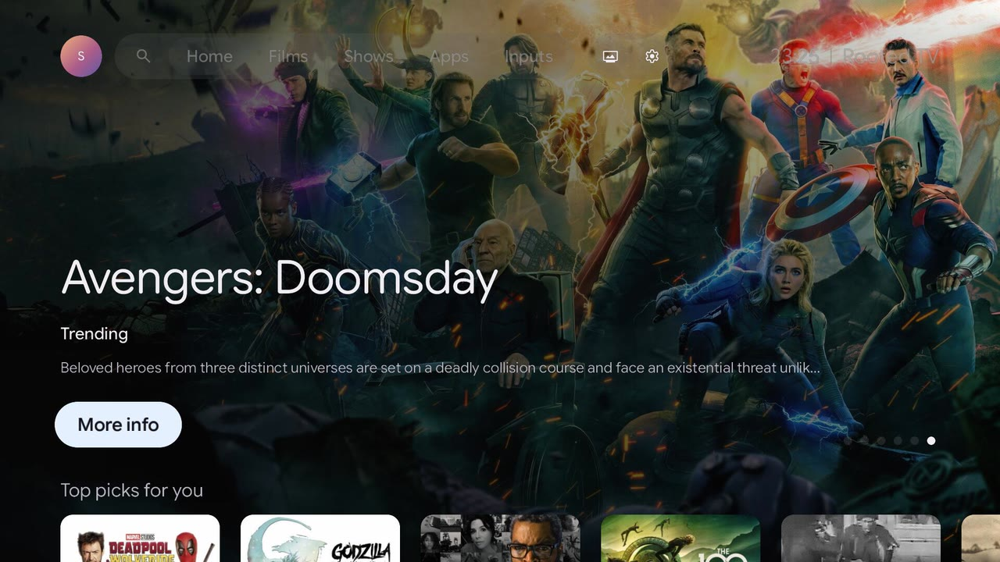
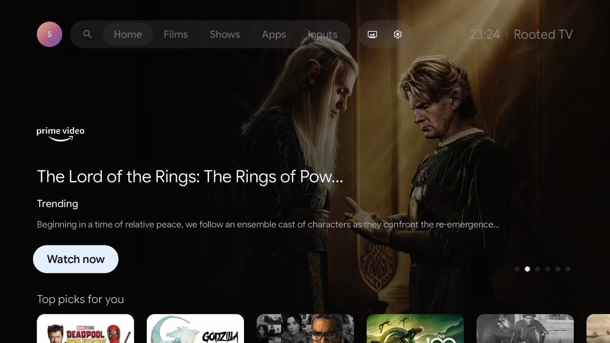
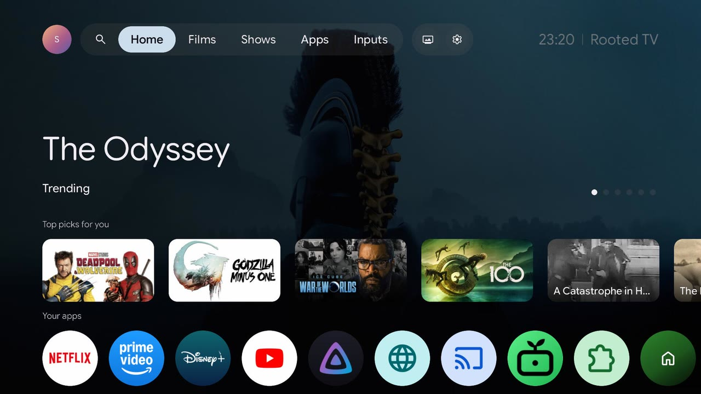
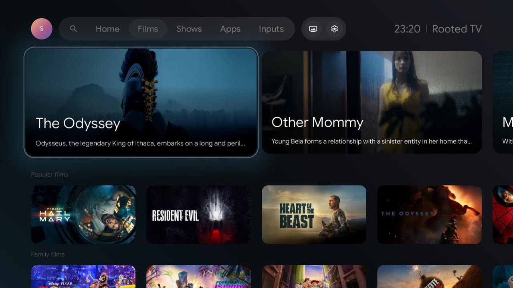
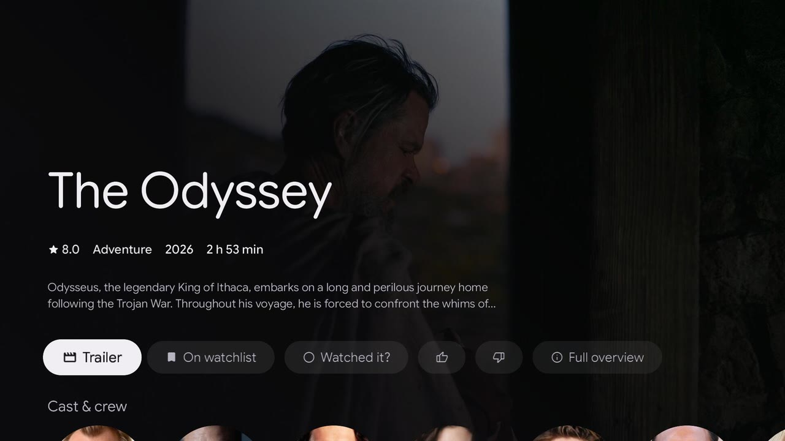
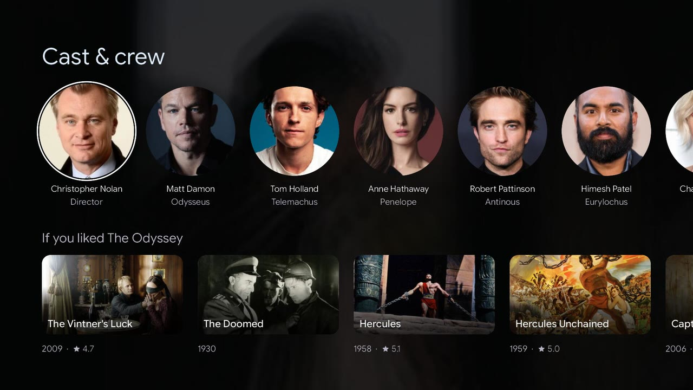
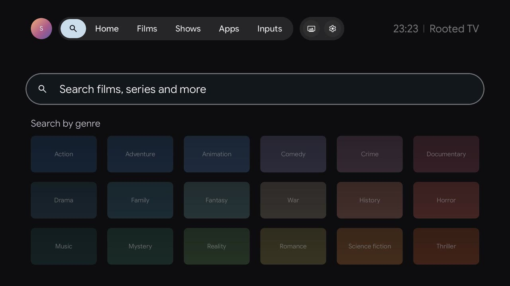
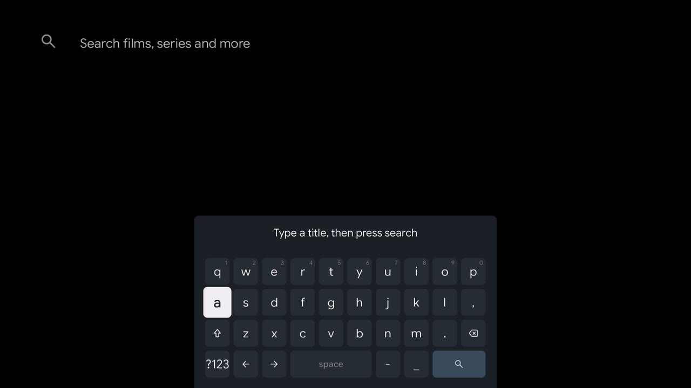
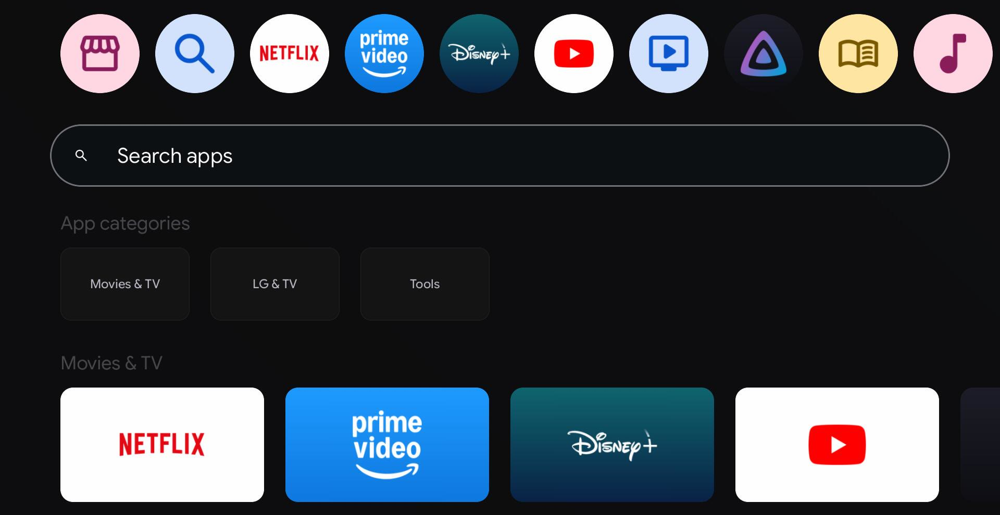
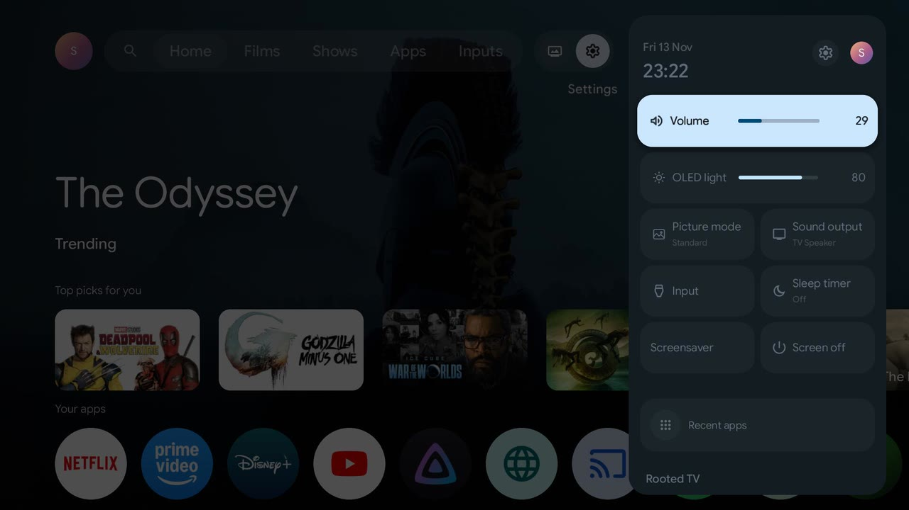

# A tour of Rooted TV Home

Rooted TV Home is the launcher: Google TV's home screen, drawn by Rooted TV's own C++ and OpenGL ES client on the TV, at the display's 60 frames a second and with Google TV's system sound on each key. On webOS 3.4 it opens on the remote's Home button and when the TV comes on, in place of LG's ribbon. [Home](../dashboard/home.md) has the switches, the rows and how it takes over from LG's Home; [the TV app](tv-app.md) has the app's other screens.

Every picture on this page is a capture from an LG OLED55C6V (webOS 3.4.3) with its menus in English. The app speaks the TV's menu language, so a TV in Italian shows it in Italian.

<figure markdown="span">
  
</figure>

## Home

Across the top, a banner of the week's trending titles, after Google TV's: the art fills the screen and fades into the black, the title is set in Google Sans Flex with rounded ends as Google TV sets its big titles, and the banner moves to the next title every 12 seconds. A title that a streaming service on the TV has shows that service's wordmark, and **Watch now** opens the title itself in Prime Video or Disney+; the others have **More info**, which opens their page.

<figure markdown="span">
  
  <figcaption>The banner, where Home opens.</figcaption>
</figure>

<figure markdown="span">
  
  <figcaption>A series on Prime Video: its wordmark, and Watch now in place of More info.</figcaption>
</figure>

Under it come the rows. **Top picks for you** (chosen by Gemini where a Gemini key is set) and **Your apps**, the TV's apps as Google TV's round icons, come first; then Continue watching, what is popular on Netflix, Prime Video and Disney+ in the TV's country, and YouTube's trending videos and each profile's subscriptions. With the focus on the bar, the banner drops its overview and button and the rows move up.

<figure markdown="span">
  
  <figcaption>The rows under the banner: Top picks for you and Your apps.</figcaption>
</figure>

The bar is Google TV's: the profile's avatar, search and the tabs in one capsule, the screen saver and the gear in another, and the clock and the Rooted TV name at the right. The pill on the tabs follows the focus.

## Films and Shows

The Films and Shows tabs open on up to eight of the week's trending titles as large cards, each with its title and the start of its summary over its picture, and then rows from TMDB by kind: popular, family, top rated and the genres. The focused row rises to the top with two lines under each card: the focused title's name, then the service that has it, its year and its rating.

<figure markdown="span">
  
  <figcaption>The Films tab, with the first large card focused.</figcaption>
</figure>

## A title's page

OK on any title opens its page, as Google TV's: the title, its rating, genre, year and length, two lines of its overview, and its actions: **Trailer** (in HD, from the title's Apple TV page where it has one), the watchlist, **Watched it?**, the thumbs and **Full overview**, with **Watch on Prime Video** or **Disney+** first where one of them has it. Down goes to its cast and crew and to the titles like it, while the picture behind turns into a dark blur of itself.

<figure markdown="span">
  
  <figcaption>A film's page, with Trailer focused.</figcaption>
</figure>

<figure markdown="span">
  
  <figcaption>Further down: Cast & crew, and If you liked the title.</figcaption>
</figure>

## Search

Search finds titles by name or by genre, and the apps of LG Content Store, which install from the results. The keyboard is Google TV's, laid out for the remote.

<figure markdown="span">
  
  <figcaption>Search, with its genres.</figcaption>
</figure>

<figure markdown="span">
  
  <figcaption>The on-screen keyboard.</figcaption>
</figure>

## Apps

The Apps tab is Google TV's: large banners of the TV's apps for films, music and games, each the app's icon on its own colour; **Your apps**, every app on LG's Home as a round icon; **Search apps**; **App categories**, a page for each kind of app; and LG Content Store in the Play Store's place.

<figure markdown="span">
  
  <figcaption>The Apps tab.</figcaption>
</figure>

## Quick settings

The gear opens Google TV's Quick settings panel over the page: the date and clock, the volume, the OLED light, the picture mode, the sound output, the input, the sleep timer, the screen saver, the screen off and the recent apps. The gear at its top opens Rooted TV's own [Settings](tv-app.md#settings).

<figure markdown="span">
  
  <figcaption>Quick settings, opened over Home.</figcaption>
</figure>

## And the rest

* **Inputs**: every HDMI input, with a tile for each device the TV knows on it over HDMI-CEC. [Home](../dashboard/home.md) has the details.
* **Profiles**: Google TV's account chooser, with YouTube signed in for each profile.
* **Screen savers**: Google TV's own, an ambient mode with the owner's photos, a clock and the others in [Screen savers](../dashboard/screen-savers.md), in place of LG's.
* **The design**: every size, colour and motion comes from Google's TV Design Kit, measured against a Chromecast with Google TV: [Material 3 Expressive](../development/material-3-expressive.md) has the tables, and [How smooth it is](tv-app.md#how-smooth-it-is) how the app holds 60 frames a second.
