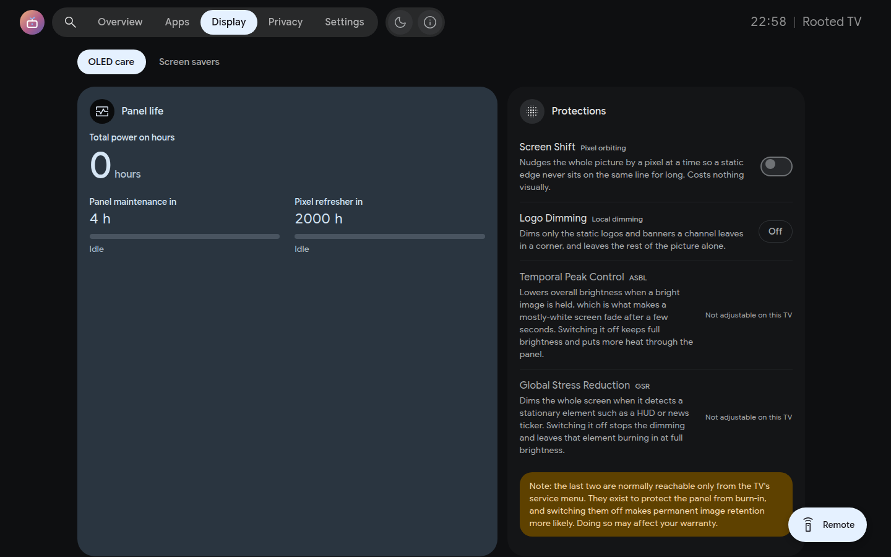

# OLED wear and burn-in protection

The **OLED care** tab of the **Display** section, `/?tab=oledcare`, brings together the panel's own wear figures with the protections that affect OLED wear.

The aim is not to encourage disabling OLED protections blindly. Instead, the dashboard shows what each control does and exposes the controls that the particular panel makes available.

* Cumulative panel hours, panel maintenance and Pixel Refresher countdowns, completed cycle counters and refresher failure alerts. A refresher is scheduled from the TV app's OLED Care page or from Home Assistant, not from this tab. Maintenance never reads as running while the TV is on with its screen lit, since LG runs it only once the TV is switched off.
* GSR stress events on supported panels — counts how many static image stress intervals (such as logos, HUDs, or news tickers) the panel has detected, even if active dimming is switched off.
* Screen shift on any OLED, and logo dimming where the TV has it. An OLED on webOS 3.4, whose panel has no logo dimming, GSR or temporal peak control, gets Rooted TV's own logo dimming in that row (below).

**Logo dimming on webOS 3.4** is the server's: every 10 seconds, while another app's picture is on screen (not Rooted TV's own screens, which dim themselves when idle), it takes a 64 × 36 capture of the whole screen. A bright element (a channel's logo, a score, a game's HUD) that stays put for two minutes while the rest of the picture moves lowers the OLED light of the whole picture, 4 points at a time, by 15 % (**Light**, the default) or 30 % (**Strong**), and once it has gone the light comes back, 10 points at a time. LG keeps an OLED light for each input and picture mode; the one lowered is that of the picture on screen, and it is put back as soon as the picture is of another. A picture that stands still whole is left to the panel's own ASBL. Changing the OLED light meanwhile makes that value the owner's, and the dimming waits for the next element. The owner's light is kept in `/var/lib/tvweb/static-dimming.json` while it is lowered, so a restart of the server puts it back. The level is `staticDimming` in `config.json` (`off`, `light`, `strong`).
* Temporal peak control (ASBL) and global stress reduction on supported models (the two normally reachable only from the TV's service menu, with a service remote and a PIN).

*OLED panel wear information, maintenance cycle progress and burn-in protection controls.*

